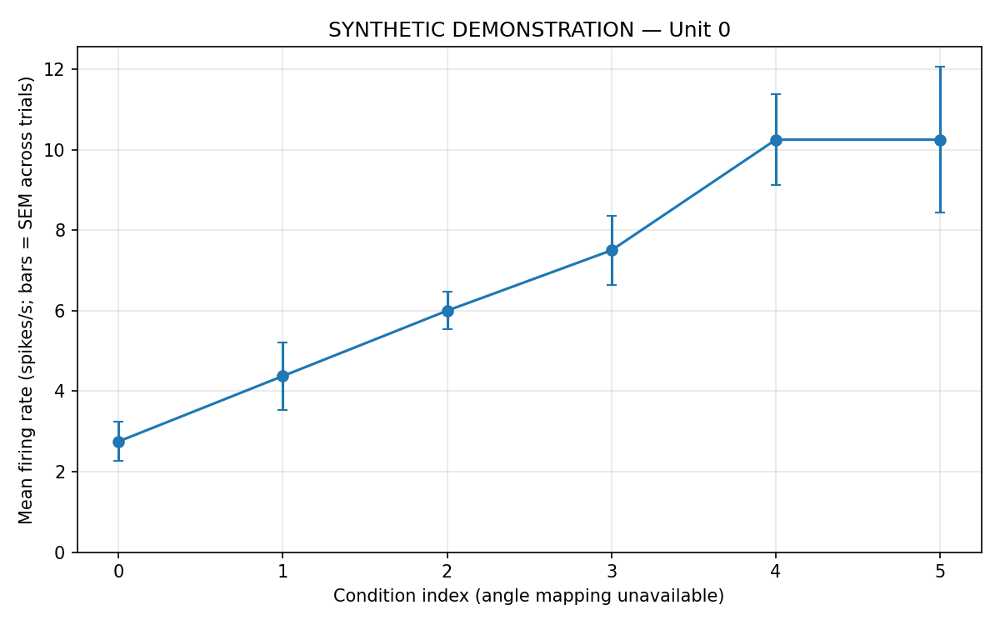

# Spike-rate responses across stimulus conditions

[Analysis script](analyze_v1_tuning.py) · [Repository setup and checks](../README.md)

This workflow reads a CRCNS pvc-11 MATLAB file with `data.EVENTS[unit, condition, trial]` cells containing spike times in seconds. For each unit and condition it counts spikes in an inclusive analysis window, divides by its duration, and reports the mean rate and descriptive SEM across trials. Empty spike vectors are zero-spike trials. SEM is undefined (NaN) with only one trial.

The default window is **[0.28,1.28] seconds**, an explicit analysis choice rather than an automatically inferred stimulus interval. No baseline subtraction, tuning-curve fitting, orientation-selectivity test or preferred-angle estimate is performed.

## Input and provenance

Obtain the appropriate evoked/gratings MATLAB file through the [CRCNS pvc-11 dataset page](https://crcns.org/data-sets/vc/pvc-11/about), following its access requirements. The repository does not bundle those recordings. Use the actual downloaded path; do not rename unrelated files to match an example filename.

From the repository root:

```bash
python Analysis-of-Orientation-Tuning-in-V1-Neurons/analyze_v1_tuning.py --input /path/to/data_monkey1_gratings.mat --output outputs/gratings
```

MATLAB v7.3/HDF5 files are not supported by this scipy.io.loadmat implementation. Missing files, malformed structures, invalid spike times and inconsistent angle mappings return a nonzero exit status.

## Angle metadata

The previous assumed twelve-angle mapping has been removed. Any positive number of conditions is supported, and plots default to **condition index**, not orientation.

To label angles, supply a CSV with `condition_index,angle_degrees`, covering every zero-based condition exactly once, and state whether these are `orientation` (0 <= angle < 180) or drift `direction` (0 <= angle < 360). Verify that mapping against the actual recording metadata before use.

```bash
python Analysis-of-Orientation-Tuning-in-V1-Neurons/analyze_v1_tuning.py --input /path/to/gratings.mat --angles /path/to/verified_angles.csv --angle-kind direction --output outputs/gratings
```

## Outputs and runnable demonstration

The output directory contains `firing_rates.csv` for all units/conditions and up to 20 per-unit figures (configurable with `--max-neurons`). Error bars show SEM across recorded trials; they are not fitted tuning confidence intervals. The analysis window is configurable with `--start` and `--end`.

```bash
python Analysis-of-Orientation-Tuning-in-V1-Neurons/analyze_v1_tuning.py --demo --output outputs/demo
```

The seeded demonstration generates synthetic spike times and visibly labels every plot and CSV row. It is a software demonstration, not a result from the CRCNS recordings.



Validation used numerical fixtures and generated MATLAB files. The actual CRCNS MATLAB input and its angle mapping were unavailable, so biological findings and real-data orientation tuning are not claimed. The original broken links to nonexistent recording plots have been replaced by the labelled demonstration above.

Dataset reference: Kohn, A., & Smith, M. A. (2016). CRCNS pvc-11. [Dataset DOI](https://doi.org/10.6080/K0NC5Z4X).
